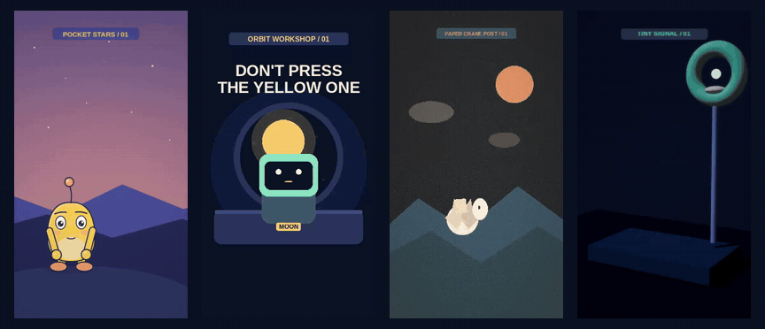
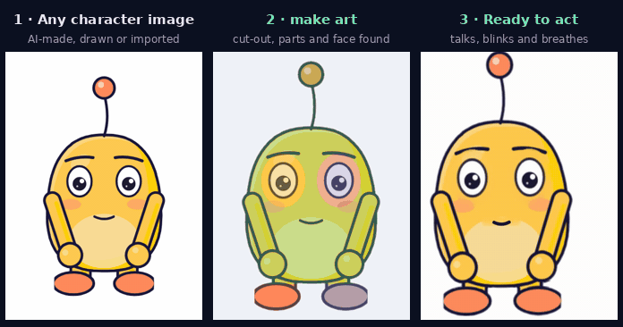
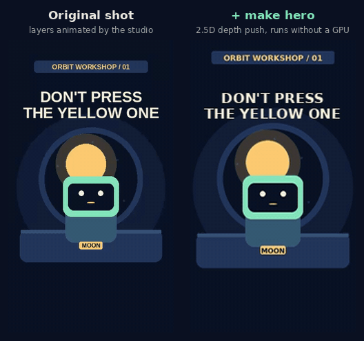
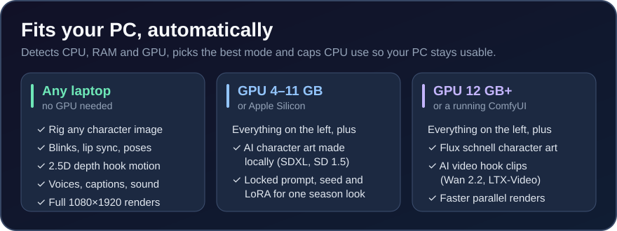
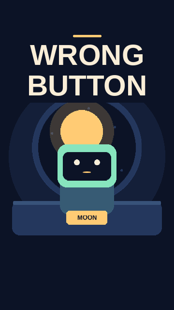

<h1 align="center">🎬 Viral Short Videos AI</h1>

<p align="center"><strong>Your AI assistant becomes an animation studio for YouTube Shorts and TikTok.</strong><br>
Characters that talk and blink, hooks that move, captions that pop, all rendered on your own PC.</p>

<p align="center">
  <a href="#-quick-start"></a>
  <a href="#-fits-your-pc"></a>
  <a href="https://github.com/fiwon123/viral-short-videos-ai/wiki"></a>
</p>

<p align="center">
  
  
  
  <a href="LICENSE"></a>
</p>

<p align="center">
  
</p>

<p align="center"><em>Made with the studio on a regular computer: no paid services, no GPU.</em></p>

---

## ✨ What you can make

<table>
  <tr>
    <td width="33%" valign="top">
      <h3>🎭 Characters that act</h3>
      Turn any character image into a rig that breathes, blinks and lip-syncs. Or let a local AI model draw your cast.
    </td>
    <td width="33%" valign="top">
      <h3>🪝 Hooks that stop the scroll</h3>
      Preview just the first 20 seconds, add punchline pauses, score the hook, and give the opening shot depth or AI motion.
    </td>
    <td width="33%" valign="top">
      <h3>💬 Voices and captions</h3>
      Local voices, captions timed to every spoken word, sound effects on the right words and beats, and music cut to fit the episode on its bar lines.
    </td>
  </tr>
  <tr>
    <td width="33%" valign="top">
      <h3>🎥 Real animation tools</h3>
      Poses, IK, motion recipes, camera moves, 2.5D depth, 3D scenes, physics, and video layers for your own footage.
    </td>
    <td width="33%" valign="top">
      <h3>📺 A channel that remembers</h3>
      It interviews you, researches trends, builds the brand kit, locks the look, and keeps a memory of every episode.
    </td>
    <td width="33%" valign="top">
      <h3>📦 Ready to upload</h3>
      A checked 1080×1920 MP4, thumbnail, captions file, and titles, descriptions and tags for YouTube and TikTok.
    </td>
  </tr>
</table>

## 🎭 Any character, ready to act

<p align="center">
  
</p>

Give it a picture, from an AI image generator, your own drawing or an import, and `make art` does the rest: it cuts the character out, finds the body, arms, legs, eyes and mouth, and builds a rig. The eyes blink, the body breathes, and a 13-shape mouth lip-syncs to the voice. With a GPU it can also draw the character for you, using only models licensed for commercial use. [How it works →](https://github.com/fiwon123/viral-short-videos-ai/wiki/AI-Characters-and-Hook-Clips)

## 🪝 Make the first seconds count

<table>
  <tr>
    <td align="center" width="55%"><br><sub><b>make hero</b>: depth motion for the opening shot, or an AI video clip on a GPU</sub></td>
    <td align="center" width="45%"><br><sub>Kinetic word captions, poses and idle motion</sub></td>
  </tr>
</table>

- **Approve the hook first:** `make preview HOOK=20` renders only the opening 20 seconds, with sound.
- **Let jokes land:** mark a line `"punchline": true` for a beat of silence.
- **Check before you post:** `make viral-check` scores the hook, pacing, loop, loudness and packaging.

## 🎬 Directed, reviewed, delivered

The studio works like a small production team. Each step has a check that measures what you would otherwise have to spot by eye, and says how to fix it.

| Step | Command | What it catches |
| --- | --- | --- |
| **Study** | `make reference` | Timecoded YouTube reference evidence and a comparison for editorial review. |
| **Script** | `make script` | A pre-animation shot script and a voice script ready to record. |
| **Voice import** | `make voice-import` | Per-line takes and word timing from one full recording or one recording per speaker. |
| **Plan** | `make treatment-lint` | A hook that takes too long, one shot size for the whole film, a camera that only pushes in, an ending that never lands. |
| **Build** | `make validate` | A camera that runs past the edge of the set, or drifts there and back inside one shot. |
| **Voice** | `make narration-check` | Lines the voice dropped, repeated or misread, heard back against the script. |
| **Render** | automatic | Every render measures itself: dead stretches, frozen endings, a wrong first frame, sounds that miss their action, blended cuts. |
| **Review** | `make review-pack` · `make review` | Cold reviewers by lens (director, sound, continuity), and notes you leave by clicking the frame itself. |
| **Deliver** | `make deliver` | A damaged file, loudness off target, clipping peaks, a sound cut off at the end; the facts are sealed in `delivery.md`. |

`make state` tells you where any episode stands and the exact next command, so you can stop and pick up again anytime. [The full quality guide →](https://github.com/fiwon123/viral-short-videos-ai/wiki/QA-Export-and-Publishing)

To study references at channel creation or before an episode, pass up to three public YouTube video URLs, or pass the creator's channel with `TOP=3`.

```sh
make reference CHANNEL=my-channel URL='https://www.youtube.com/@example' TOP=3
```

Downloads and platform captions stay under `reference-media/` for local study. Each breakdown, comparison and editable `patterns.md` goes under the channel's `research/references/`. The comparison states how many indexed Shorts had usable view counts. Set `SUB_LANGS` for additional caption languages. On the host, `make setup-host` installs the downloader and recognizer. Run `make dev-build` to refresh an existing sandbox image.

Write the episode script with `make script EPISODE=...`, record the lines in order, then import the audio:

```sh
make voice-import EPISODE=workspace/my-channel/episodes/my-episode/episode.json FILE='full voice.mp3'
```

Add `SPEAKER=<name>` for one file per speaker and `LANGUAGE=pt` to set the recognizer language explicitly. Check partial, inferred, and missing lines in `voice-import.json`, then run `make audio` and `make narration-check` before animating to the new takes.

## 💻 Fits your PC

<p align="center">
  
</p>

You never configure hardware. Every command detects your CPU, RAM and GPU, picks the best mode, runs at low priority, and caps CPU threads so your computer stays usable. Want to experiment? Every limit can be changed. [See the options →](https://github.com/fiwon123/viral-short-videos-ai/wiki/Your-PC-and-Performance)

## 🚀 Quick start

**1 · Get it.** You need [Docker](https://docs.docker.com/get-docker/); everything else ships in the image.

```sh
git clone https://github.com/fiwon123/viral-short-videos-ai.git
cd viral-short-videos-ai
make models art-models   # voice, depth and cut-out models, once
```

**2 · Start your AI assistant inside the studio.**

```sh
make claude              # or: make codex, make opencode
```

**3 · Paste a prompt** from below and review what it makes. That's it.

<details>
<summary>🖥️ Prefer to install on your computer instead of Docker?</summary>

Install Python 3.10–3.13, FFmpeg with FFprobe, eSpeak NG, Node.js 22+ and Chrome or Chromium, then:

```sh
make setup-host   # venv, npm packages, voice files
make doctor       # checks every dependency
make hardware     # shows what your PC can do
```

Then open the folder in your AI assistant. On Windows without WSL, use `python scripts/dev-up.py claude` for the Docker route. [Full guide →](https://github.com/fiwon123/viral-short-videos-ai/wiki/Quick-Start)
</details>

## 🤖 Copy a prompt

<details open>
<summary>🎨 <b>Start a new channel</b></summary>

```text
Read AGENTS.md and .agents/skills/viral-video-studio/SKILL.md.
Help me start an animated Shorts channel. Ask me one question at a time about
audience, tone, topic, format, animation style, platform, length and voice.
Then show me the Shorts growing fastest in that space this week and propose
three original directions. Let me pick one, then build its brand kit and cast,
set up the channel memory, and render a preview of the first episode.
```
</details>

<details>
<summary>🎬 <b>Make a video for my channel</b></summary>

```text
Use the approved identity and cast for [channel]. Turn [idea] into a
[runtime] animated Short in [language] for [platform].
Give me a timed shot plan, show me the hook preview, then export the MP4,
thumbnail, captions and publishing copy.
```
</details>

<details>
<summary>🎭 <b>Bring my own character</b></summary>

```text
Here is my character image: [path]. Rig it for [channel] with make art,
show me the preview, then make a 15-second test where it talks and waves.
```
</details>

<details>
<summary>🔍 <b>Review and deliver my video</b></summary>

```text
Read the film-QA report of the latest preview of [episode], then prepare the
review pack and have a reviewer that did not build it check each lens.
Fix what matters, render the master, run make deliver, and tell me what
changed and what each amber item means.
```
</details>

<details>
<summary>📅 <b>Plan a batch of episodes</b></summary>

```text
Use the approved format, cast and style for [channel]. Propose five episodes
with distinct hooks and payoffs. Use my analytics if I share them. Recommend
one change to test across the batch, then prepare previews and publishing copy.
```
</details>

[More prompts in the wiki →](https://github.com/fiwon123/viral-short-videos-ai/wiki/AI-Workflow-and-Prompt-Cookbook)

## 🎞️ Examples

<table>
  <tr>
    <td align="center" width="25%"><a href="examples/pocket-stars"><br><b>Pocket Stars</b></a><br><sub>Rigged character · kinetic captions</sub></td>
    <td align="center" width="25%"><a href="examples/orbit-workshop"><br><b>Orbit Workshop</b></a><br><sub>2D/2.5D · karaoke captions</sub></td>
    <td align="center" width="25%"><a href="examples/paper-crane"><br><b>Paper Crane Post</b></a><br><sub>Camera moves · sound stems</sub></td>
    <td align="center" width="25%"><a href="examples/tiny-signal"><br><b>Tiny Signal</b></a><br><sub>3D lighting · mastered sound</sub></td>
  </tr>
</table>

Each example has the MP4, the editable episode, the channel identity and the publishing copy. [Explore the examples →](https://github.com/fiwon123/viral-short-videos-ai/wiki/Examples)

## 💰 Built for monetized channels

| Platform | Milestones to track |
| --- | --- |
| **YouTube Shorts** | 500 subscribers and 3M Shorts views in 90 days for the first YPP tier; 1,000 subscribers and 10M views for ads revenue (20M from February 1, 2027). [YouTube eligibility](https://support.google.com/youtube/answer/94522) |
| **TikTok Creator Rewards** | 10,000 followers and 100,000 views in 30 days; videos of at least 1 minute. [Creator Rewards](https://support.tiktok.com/en/business-and-creator/creator-rewards-program/creator-rewards-program) |

Rules change by region, so check your dashboard. [Full monetization guide →](https://github.com/fiwon123/viral-short-videos-ai/wiki/YouTube-and-TikTok-Monetization)

## 📚 Learn more

| Topic | Guides |
| --- | --- |
| 🚀 **Get started** | [Quick Start](https://github.com/fiwon123/viral-short-videos-ai/wiki/Quick-Start) · [Your PC and Performance](https://github.com/fiwon123/viral-short-videos-ai/wiki/Your-PC-and-Performance) · [Examples](https://github.com/fiwon123/viral-short-videos-ai/wiki/Examples) |
| 🎨 **Create** | [Create a Channel](https://github.com/fiwon123/viral-short-videos-ai/wiki/Create-a-Channel) · [AI Characters and Hook Clips](https://github.com/fiwon123/viral-short-videos-ai/wiki/AI-Characters-and-Hook-Clips) · [Prompt Cookbook](https://github.com/fiwon123/viral-short-videos-ai/wiki/AI-Workflow-and-Prompt-Cookbook) |
| ✅ **Review** | [QA, Export and Publishing](https://github.com/fiwon123/viral-short-videos-ai/wiki/QA-Export-and-Publishing) · [Audio and Sound Design](https://github.com/fiwon123/viral-short-videos-ai/wiki/Audio-and-Sound-Design) · [Motion, Camera and Rigs](https://github.com/fiwon123/viral-short-videos-ai/wiki/Motion-Camera-and-Rigs) |
| 📈 **Grow** | [Make Shorts Travel](https://github.com/fiwon123/viral-short-videos-ai/wiki/Make-Shorts-Travel) · [Batch Production](https://github.com/fiwon123/viral-short-videos-ai/wiki/Automate-a-Channel) · [Monetization](https://github.com/fiwon123/viral-short-videos-ai/wiki/YouTube-and-TikTok-Monetization) |
| 🛠️ **Reference** | [Creative Controls](https://github.com/fiwon123/viral-short-videos-ai/wiki/Creative-Controls) · [Manifest Reference](https://github.com/fiwon123/viral-short-videos-ai/wiki/Manifest-Reference) · [Renderer Support](https://github.com/fiwon123/viral-short-videos-ai/wiki/Renderer-Support) · [Troubleshooting](https://github.com/fiwon123/viral-short-videos-ai/wiki/Troubleshooting) |

<p align="center"><sub>MIT licensed · Made for creators who want to ship original animated Shorts, not copies. No one can promise a viral video; the studio helps you make one worth watching.</sub></p>
