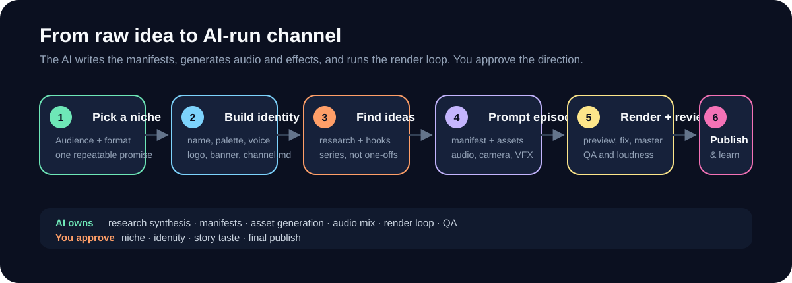
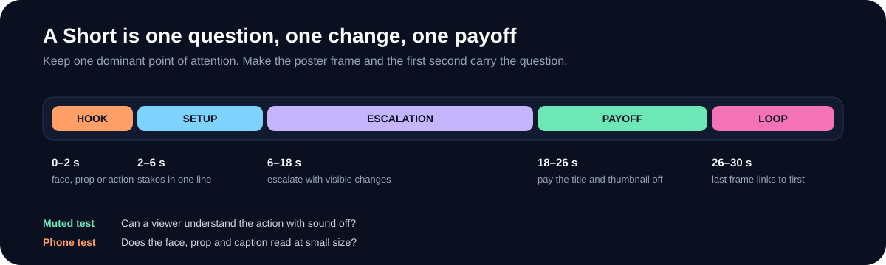
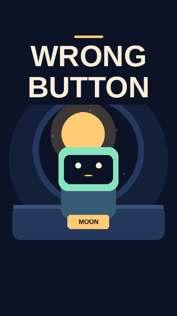
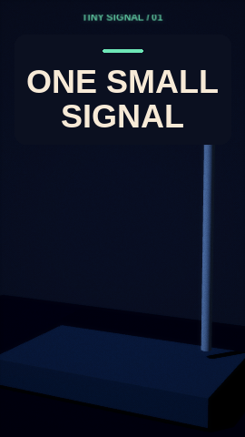

<h1 align="center">🎬 Viral Short Videos AI</h1>

<p align="center"><strong>Build an original animated channel with AI, then turn ideas into videos ready for upload.</strong></p>

<p align="center">
  <a href="#-build-with-ai"></a>
  <a href="#-plan-for-monetization"></a>
  <a href="https://github.com/fiwon123/viral-short-videos-ai/wiki"></a>
  <a href="LICENSE"></a>
</p>

<p align="center">
  
</p>

## 🤖 Build with AI

Open this repository in an AI assistant that can read and edit local files and run commands. Choose a starting point and copy the matching prompt.

| I want to… | What you can make |
| --- | --- |
| 🎨 **Start a channel** | Compare niches, choose a series format, and create a name, logo, banner, and voice guide. |
| 🎬 **Make a video** | Turn an idea into an animated Short with captions, sound, a thumbnail, and publishing copy. |
| 📅 **Grow an existing channel** | Reuse the cast and visual style, plan a batch of episodes, and test one change at a time. |

<details>
<summary>🎨 Start a channel</summary>
  
```text
Read AGENTS.md and .agents/skills/viral-video-studio/SKILL.md.
Help me build an animated Shorts channel for [audience] on [YouTube or TikTok].
Propose three original series formats. For each, give me a recurring hook,
a sample episode, and an estimate of the work per video. Let me pick one.
Then build its brand kit and render a preview of the first episode.
```

</details>

<details>
<summary>🎬 Make one video for an existing channel</summary>

```text
Use the approved identity and assets for [channel]. Turn [idea] into a
[runtime] animated video in [language] for [platform].
Give me a timed shot plan, then render a preview with captions and sound.
After review, export the MP4, thumbnail, editable source, and publishing copy.
```

</details>

<details>
<summary>📅 Plan a batch for an existing channel</summary>

```text
Use the approved format, cast, and style for [channel]. Propose five episodes
with distinct hooks and payoffs. Use my analytics if I share them and compare
uploads at the same age. Recommend one change to test across the batch.
After I approve the plan, prepare previews and publishing copy.
```

</details>

**✅ Review the direction, story, and preview.** The assistant prepares the assets, runs the checks, and renders locally. For a chat-only AI, share the [studio skill](.agents/skills/viral-video-studio/SKILL.md) and have it return prompts, manifests, and commands you can run locally. [More prompts in the Wiki](https://github.com/fiwon123/viral-short-videos-ai/wiki/AI-Workflow-and-Prompt-Cookbook)

## 💰 Plan for monetization

| Platform | What to track |
| --- | --- |
| **YouTube Shorts** | In eligible regions, expanded YPP starts at **500 subscribers**, **3 valid public uploads in 90 days**, and **3M qualified Shorts views in 90 days** on the Shorts route. The current ads and Premium entry path requires **1,000 subscribers** and **10M qualified Shorts views in 90 days**. [YouTube eligibility](https://support.google.com/youtube/answer/94522) |
| **TikTok Creator Rewards** | In eligible regions, track **10,000 followers** and **100,000 views in 30 days**. Eligible original videos must run **at least 1 minute** and reach **1,000 qualified For You views** to begin earning. [TikTok Creator Rewards](https://support.tiktok.com/en/business-and-creator/creator-rewards-program/creator-rewards-program) |

> [!IMPORTANT]
> From **February 1, 2027**, the YouTube Shorts route for new ads and Premium applicants rises to **20M qualified views in 90 days**. A separate **10M-view threshold** applies to monthly Shorts Creator Pool earnings. Check availability and progress in your platform dashboard. [YouTube announcement](https://support.google.com/youtube/answer/12843009)

[See the full monetization guide, including watch-hour routes and application checklists](https://github.com/fiwon123/viral-short-videos-ai/wiki/YouTube-and-TikTok-Monetization).

## 🎯 Focus a Short so it can travel

<p align="center">
  
</p>

- **One question** in the first frame.
- **One visible change** every few seconds.
- **One payoff** that answers the title, thumbnail and hook.
- **A loop** that makes the last frame lead back to the first.
- **A phone test** with sound and muted.

No one can guarantee a viral video. These choices make the story easier to stop for, finish and share. [Full guide](https://github.com/fiwon123/viral-short-videos-ai/wiki/Make-Shorts-Travel).

## 🎞️ See what you can make

<table>
  <tr>
    <td align="center" width="33%"><a href="examples/orbit-workshop"><br><strong>Orbit Workshop</strong></a><br>2D/2.5D · karaoke captions</td>
    <td align="center" width="33%"><a href="examples/paper-crane"><br><strong>Paper Crane Post</strong></a><br>Character rig · camera movement</td>
    <td align="center" width="33%"><a href="examples/tiny-signal"><br><strong>Tiny Signal</strong></a><br>3D lighting · mastered sound</td>
  </tr>
</table>

Each example includes a preview MP4, editable episode source, channel identity, and publishing copy. [Watch the previews and explore the examples](https://github.com/fiwon123/viral-short-videos-ai/wiki/Examples).

## 🛠️ Install and render locally

Install **Python 3.10+** and **FFmpeg with FFprobe**. For SVG or 3D rendering, also install **Node.js 22+** and **Chrome or Chromium**.

```sh
git clone https://github.com/fiwon123/viral-short-videos-ai.git
cd viral-short-videos-ai
python -m pip install -r requirements.txt
npm ci --ignore-scripts   # SVG and 3D renderers
python video.py doctor
```

Useful checks:

```sh
make support   # renderer support matrix
make parity    # shared visual fixture across renderers
make editor EPISODE=workspace/<channel>/episodes/<episode>/episode.json
```

Each channel has its own workspace. A finished episode goes to `workspace/<channel>/renders/<episode>-v1/` with the MP4, thumbnail, publishing guide, QA report, and captions when present. Existing projects using `channels/` and `episodes/` can continue exporting to `output/<channel>/`.

| Find | Guide |
| --- | --- |
| First render and commands | [Quick Start](https://github.com/fiwon123/viral-short-videos-ai/wiki/Quick-Start) |
| Multiple channels and migration | [Workspace Layout](https://github.com/fiwon123/viral-short-videos-ai/wiki/Workspace-Layout) |
| Camera, captions, sound, and effects | [Creative Controls](https://github.com/fiwon123/viral-short-videos-ai/wiki/Creative-Controls) |
| Schema and validation | [Manifest Reference](https://github.com/fiwon123/viral-short-videos-ai/wiki/Manifest-Reference) |
| Masks, markers, particles, stems, visemes | [Advanced Controls](https://github.com/fiwon123/viral-short-videos-ai/wiki/Advanced-Controls) |
| What each renderer supports | [Renderer Support](https://github.com/fiwon123/viral-short-videos-ai/wiki/Renderer-Support) |
| Upload package and fixes | [QA, Export and Publishing](https://github.com/fiwon123/viral-short-videos-ai/wiki/QA-Export-and-Publishing) · [Troubleshooting](https://github.com/fiwon123/viral-short-videos-ai/wiki/Troubleshooting) |

MIT licensed. [LICENSE](LICENSE)
