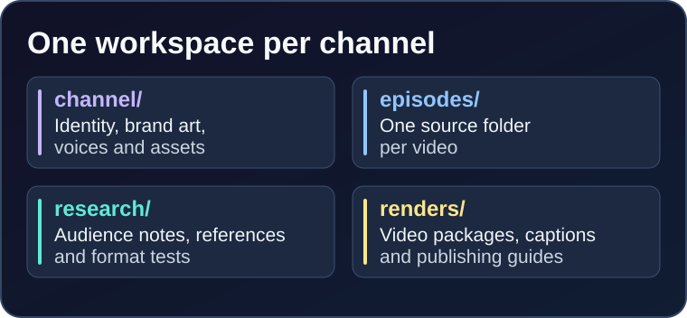
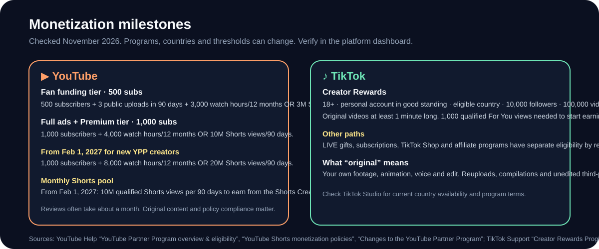

<h1 align="center">🎬 Viral Short Videos AI</h1>

<p align="center">
  <strong>An AI-first studio for building an original animated channel and shipping Shorts.</strong><br>
  Research a niche, define a channel, generate ideas, write timed episodes, create audio and VFX, render a verified MP4, and package the upload.
</p>

<p align="center">
  <a href="https://github.com/fiwon123/viral-short-videos-ai/wiki/Quick-Start"></a>
  <a href="https://github.com/fiwon123/viral-short-videos-ai/wiki/AI-Workflow-and-Prompt-Cookbook"></a>
  <a href="https://github.com/fiwon123/viral-short-videos-ai/wiki/Motion-Camera-and-Rigs"></a>
  <a href="LICENSE"></a>
</p>


## 🤖 AI-first, not manual

This repository is designed for an AI assistant to do the production work. You make the creative decisions; the AI writes the manifests, generates assets, runs the audio and visual checks, renders, and fixes routine issues.

| AI does | You approve |
| --- | --- |
| Niche research and channel positioning | The direction and audience promise |
| Channel identity, palette, logo and copy | Name, look and voice |
| Idea lists, hooks and scripts | Which story is worth making |
| Episode manifests, layers, keys, camera and captions | The final story taste |
| Voice, Foley, music, mix and master | Whether it sounds right |
| Render previews, QA reports and publishing copy | The final upload |

**No manual animation is required.** You can also edit the JSON directly, but the intended path is: describe the outcome, let the AI build the manifest and assets, review the preview, ask for changes.

## 🚀 Start in five minutes

```sh
git clone https://github.com/fiwon123/viral-short-videos-ai.git
cd viral-short-videos-ai
python -m pip install -r requirements.txt
npm ci --ignore-scripts
python video.py doctor
```

Then paste this into your AI assistant:

```text
Read AGENTS.md and .agents/skills/viral-video-studio/SKILL.md.
I want to build an AI-run animated Shorts channel for [audience] on [YouTube/TikTok].
First propose three original channel directions with a repeatable format.
After I choose one, create workspace/<channel>/channel/channel.json,
generate the brand kit and channel.md, and give me three pilot episodes.
```

The full path is in **[Quick Start](https://github.com/fiwon123/viral-short-videos-ai/wiki/Quick-Start)**.

## 🗂️ One channel = one workspace



```text
workspace/<channel>/
├── channel/          # identity, brand, audio, art, scene library, VFX
├── episodes/         # one manifest + assets per video
├── research/         # why the format works
└── renders/          # MP4, thumbnail, SRT, publishing.md, QA
```

The old `channels/`, `episodes/`, `research/` and `output/` layout still works. Consolidate one channel with `make migrate` when ready.

```sh
make migrate CHANNEL=channels/my-channel/channel.json EPISODE=episodes/my-episode/episode.json
make migrate CHANNEL=channels/my-channel/channel.json EPISODE=episodes/my-episode/episode.json APPLY=1
```

## 📈 Monetization at a glance



> Checked **November 13, 2026**. Rules and country availability change; verify in YouTube Studio and TikTok Studio.

| Platform | Current milestone | What it unlocks |
| --- | --- | --- |
| **YouTube** | 500 subscribers + 3 public uploads/90 days + 3,000 watch hours/12 months **or** 3M Shorts views/90 days | Fan funding and Shopping features (eligible countries) |
| **YouTube** | 1,000 subscribers + 4,000 watch hours/12 months **or** 10M Shorts views/90 days | Full YPP ads and Premium |
| **YouTube from Feb 1, 2027** | New YPP creators: 1,000 subscribers + 8,000 watch hours/12 months **or** 20M Shorts views/90 days | Ads and Premium entry |
| **YouTube Shorts pool from Feb 1, 2027** | 10M qualified Shorts views in the last 90 days | Monthly Shorts Creator Pool and Premium revenue |
| **TikTok Creator Rewards** | 18+ · eligible country · 10,000 followers · 100,000 views/30 days | Rewards on original videos **1+ minute**, after 1,000 qualified For You views |

Rules are country-specific and change. Full breakdown, sources and payment notes: **[YouTube and TikTok Monetization](https://github.com/fiwon123/viral-short-videos-ai/wiki/YouTube-and-TikTok-Monetization)**.

## 🎯 Focus a Short so it can travel


| Rule | What to do |
| --- | --- |
| **One question** | The first frame should make the viewer ask one specific thing |
| **First second** | Start on the face, prop or action that raises the question |
| **One change** | Escalate with visible changes, not explanation |
| **One payoff** | Pay off the title and thumbnail, then get out |
| **Loop** | End on a frame that naturally leads back to the start |
| **Phone test** | Face, prop and caption read at small size |
| **Muted test** | The action still makes sense with sound off |
| **Series** | Repeat a recognizable promise, not the same joke |

Deep dive: **[How to Make Shorts Travel](https://github.com/fiwon123/viral-short-videos-ai/wiki/Make-Shorts-Travel)**.

## 🎨 Creative controls

```json
{
  "style": {"preset": "cinematic"},
  "camera": {"preset": "push-in", "shake": {"amplitude": 0.008}},
  "motion_blur": 0.3,
  "post": {"grain": 0.12, "vignette": 0.2, "bloom": 0.24},
  "captions": {"style": "karaoke", "animation": "pop"},
  "audio": {"master": {"loudness": -14}, "reverb": {"mix": 0.08}}
}
```

AI can also create its own audio and effects:

```sh
make sound CHANNEL=workspace/my-channel/channel/channel.json RECIPE=presets/audio/custom-impact.json
make effect CHANNEL=workspace/my-channel/channel/channel.json RECIPE=presets/vfx/custom-burst.json
```

## 🧪 Complete examples

| Example | Shows |
| --- | --- |
| [Orbit Workshop](examples/orbit-workshop) | 2D/2.5D layers, karaoke, Foley, finished package |
| [Paper Crane Post](examples/paper-crane) | Parented rig, camera push-in, slide caption, whip transition |
| [Tiny Signal](examples/tiny-signal) | 3D scene, PBR/emissive materials, camera move |

Each example contains a channel identity, episode source, research note, generated `channel.md`, preview MP4 and publishing package. See [examples/README.md](examples/README.md).

## 📶 Channel maturity ladder

| Stage | You have | The AI does |
| --- | --- | --- |
| **1. Raw idea** | A niche and an audience | Research five comparable channels and propose three directions |
| **2. First channel** | A chosen name, promise and palette | Generate `channel.json`, brand kit and `channel.md` |
| **3. First five videos** | A repeatable format | Write beat sheets, manifests, audio, previews and fixes |
| **4. Series system** | A locked cast, caption style and payoff families | Batch ideas, score them, build and review episodes |
| **5. Automated channel** | A weekly review loop and analytics | Batch production, QA, packaging and one-variable tests |

Move to the next stage only when the previous one passes the [quality gates](https://github.com/fiwon123/viral-short-videos-ai/wiki/Automate-a-Channel#-quality-gates).

## 🧭 Build the channel

| Step | Read |
| --- | --- |
| Choose a niche and promise | [Create a Channel](https://github.com/fiwon123/viral-short-videos-ai/wiki/Create-a-Channel) |
| Fill `channel.json` without mistakes | [Create a Channel](https://github.com/fiwon123/viral-short-videos-ai/wiki/Create-a-Channel#fill-the-channel-fields) |
| Generate ideas and a series | [Find Ideas](https://github.com/fiwon123/viral-short-videos-ai/wiki/Find-Ideas) |
| Make an episode with prompts | [Create Videos with Prompts](https://github.com/fiwon123/viral-short-videos-ai/wiki/Create-Videos-with-Prompts) |
| Turn one-off work into a system | [Automate a Channel](https://github.com/fiwon123/viral-short-videos-ai/wiki/Automate-a-Channel) |
| Understand a technical field | [Manifest Reference](https://github.com/fiwon123/viral-short-videos-ai/wiki/Manifest-Reference) |
| Publish and troubleshoot | [QA, Export and Publishing](https://github.com/fiwon123/viral-short-videos-ai/wiki/QA-Export-and-Publishing) · [Troubleshooting](https://github.com/fiwon123/viral-short-videos-ai/wiki/Troubleshooting) |

## 🛠️ Requirements

- Python 3.10+ with `requirements.txt`
- FFmpeg and FFprobe
- Node.js 22+ and Chrome or Chromium for SVG/3D renderers
- Optional Kokoro ONNX model files for local neural voices

## 📄 License

MIT. See [LICENSE](LICENSE).
