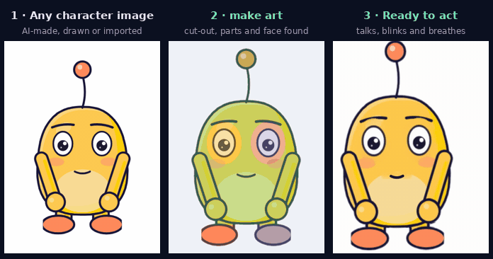
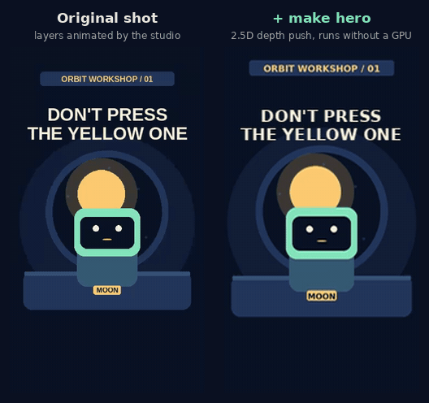

# 🎭 AI Characters and Hook Clips

Make a cast that can act, and an opening shot that moves, with local tools. Everything here picks the right mode for your PC on its own. See [Your PC and Performance](Your-PC-and-Performance).

<p align="center">
  
</p>

## Characters with `make art`

```sh
make art CHANNEL=workspace/<slug>/channel/channel.json SPEC=art/characters/<id>.json
```

What it does, in order:

1. **Choose a source.** It uses your image (`IMAGE=`), or your separated layers (`PARTS=`). Otherwise it generates one with a local image model. With no generator available, it builds the procedural character from the same spec, so the step never blocks.
2. **Cut out.** A plain background is removed with an exact colour key, which keeps thin lines such as antennae. Busy backgrounds use rembg or a local matting model (`make art-models` downloads IS-Net anime).
3. **Split.** Legs are found from the gap between the feet, the head from the neck, and arms from what sticks out beside the body. A character without a separate head (a blob) keeps its face on the body.
4. **Face.**
   - The eyes move onto their own feathered layers, with skin painted underneath, so blinks look right.
   - The painted mouth is replaced by a 13-shape mouth set in the art's line colour, so the character lip-syncs.
5. **Rig.** It writes a role-tagged rig with starter poses into the channel rig library. `alive`, `pose_keys`, `ik` and motion recipes work on it like on any rig.

Open `art/characters/<id>/preview.png` (the cut-out, and the split tinted by part) before casting. `art.json` records the model, licence, seed, cut-out method and face boxes.

### The spec

```json
{
  "id": "mika",
  "description": "a cheerful courier fox girl with a red scarf",
  "style": "flat cel-shaded cartoon, bold clean outlines, soft pastel palette",
  "seed": 1234,
  "height": 0.32
}
```

| Field | Use |
| --- | --- |
| `description`, `style`, `negative` | The prompt. The studio adds a full-body, front-view, plain-background pose so the split works. |
| `seed`, `model`, `lora` | Lock one look. A source image is cached by prompt, model and seed, so the same character comes back every time. |
| `art/style.json` | Shared `style`, `negative`, `model` and `lora` for the whole cast. |
| `image`, `parts_dir` | Rig your own art (also `IMAGE=` and `PARTS=` on the command line). |
| `parts` | Boxes that override the automatic split: `{"head": [x0, y0, x1, y1]}` in fractions of the character. |
| `face` | Boxes for `eyes` and `mouth` in fractions of the head, or `false` to keep the face as drawn. |
| `cutout` | `auto` (default), `key`, `onnx` or `rembg`. |
| `fallback` | Fields for the procedural character used when nothing can generate. |
| `allow_noncommercial` | Needed to use weights such as Flux dev. Off by default. |

### Which model runs

| Your PC | Image model |
| --- | --- |
| ComfyUI running | The best installed checkpoint for its GPU: Flux schnell, Qwen-Image, SDXL, SDXL-Turbo or SD 1.5 |
| GPU with 12 GB or more | Flux schnell (via `diffusers`) |
| GPU with 7–11 GB, or Apple Silicon | SDXL |
| GPU with 4–6 GB | SD 1.5 |
| No GPU | None by default: use `IMAGE=` with art made elsewhere, or the procedural character. `STUDIO_CPU_AI=1` allows SD 1.5 on the CPU, which takes minutes per image. |

Only weights licensed for commercial use are picked. SDXL-Turbo's licence has a revenue cap, and `art.json` notes it. `make hardware` prints the plan, and `DRY=1` shows it without generating.

> [!TIP]
> No GPU? Generate the character once with any image tool you are allowed to use commercially, on a plain background, full body, arms slightly away from the body. Then run `make art IMAGE=that.png`. Everything after that runs locally.

## Hook clips with `make hero`

```sh
make hero EPISODE=workspace/<slug>/episodes/<ep>/episode.json SHOT=A KEEP=title PROMPT="the robot leans in"
```

<p align="center">
  
</p>

- **Start frame:** by default, the shot's own first frame, and the clip goes over the shot. `IMAGE=` uses another picture as a moving background plate under the shot.
- **`KEEP=`:** layers kept sharp above the clip, such as hook titles, which video models warp.
- **Backends, best first:**
  1. ComfyUI with your exported workflow (`WORKFLOW=`, with `{{image}}`, `{{prompt}}`, `{{seed}}`, `{{frames}}`, `{{width}}`, `{{height}}`, `{{fps}}` placeholders);
  2. ComfyUI with Wan 2.2 TI2V 5B;
  3. LTX-Video on a GPU with 12 GB or more;
  4. otherwise a **2.5D depth push**: the frame is split into depth layers that zoom at different speeds. Flat cartoon shapes keep one depth each and the backdrop goes farthest, so nothing tears.
- **Output:** the clip is a full-resolution MP4 in a `video` layer. It is cached by image, prompt, seed, model and length.

From the Docker sandbox, point at a ComfyUI on your computer with `STUDIO_COMFYUI_URL=http://host.docker.internal:8188`.

## Video layers

Any MP4, WebM or MOV the channel owns can play in a shot:

```json
{"id": "clip", "kind": "video", "file": "footage/wave.mp4", "x": 0.5, "y": 0.5,
 "width": 1, "height": 1, "fit": "cover", "clip_start": 0, "clip_speed": 1, "loop": false}
```

- **Sound:** the layer is muted; put sound in `sfx`.
- **Playback:** it plays once and holds the last frame, or wraps with `loop`.
- **`fit`:** `cover` fills the box and crops; `contain` fits the whole clip inside.
- **Decoding:** frames are decoded once into `.video-frames/` beside the episode and loaded only as needed. `make archive` clears that cache.

## Models to download once

```sh
make art-models   # Depth Anything V2 Small + IS-Net anime, Apache-2.0, about 280 MB
```

They give cleaner depth for `make hero` and `make depth-photo`, and cleaner cut-outs. Everything still works without them, using rougher fallbacks.

## 🔗 Related guides

- [Your PC and Performance](Your-PC-and-Performance)
- [Motion, Camera and Rigs](Motion-Camera-and-Rigs)
- [Make Shorts Travel](Make-Shorts-Travel)
- [Create a Channel](Create-a-Channel)
