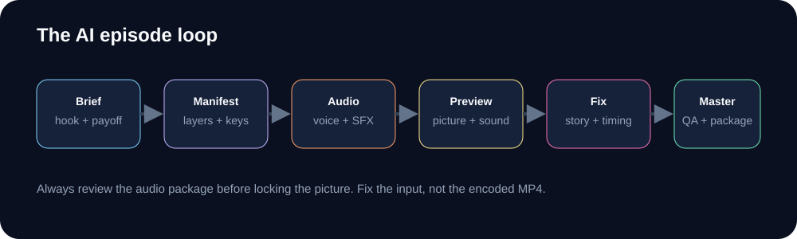

# 🎬 Create Videos with Prompts

<p align="center">
  
</p>

This page is the **creator path**. Ask the AI for outcomes; it handles the schema, layers, keys, audio and render commands. If you want to edit the technical fields yourself, use [Manifest Reference](Manifest-Reference).

## The seven-prompt sequence

### 1. Concept

```text
Use the channel brief and the chosen idea. Give me three distinct
directorial approaches: one 2D, one 2.5D, one 3D.
For each: the hook, the one visible change, the payoff, a rough runtime,
the camera idea and the sound idea. Keep the production effort similar.
```

### 2. Beat sheet

```text
Write a timed beat sheet for the chosen approach.
Include hook, setup, escalation, payoff and loop.
Give each beat a start/end time, the character action, the prop state,
the camera state and the sound idea. Keep it under [runtime] seconds.
```

### 3. Manifest

```text
Turn the beat sheet into a valid episode manifest at
workspace/<channel>/episodes/<episode>/episode.json.
Use the channel palette and recurring characters.
Use parent/pivot rigs for the character, a camera preset or keys,
karaoke captions and layered Foley.
Validate the manifest and fix every schema error before rendering.
```

### 4. Audio first

```text
Render the audio-only package. Check speaker distinctness, caption timing,
contact frames, music ducking and loudness. Fix the mix before the picture.
```

### 5. Visual preview

```text
Render a half-size preview. Check the first second, the poster frame,
the payoff, caption placement and the muted read.
List only issues that change the story or readability, then fix and re-render.
```

### 6. Finish

```text
Add a restrained finish: camera movement only where it supports a beat,
light motion blur, a soft grade, grain and vignette.
Keep the character silhouette clear at phone size.
```

### 7. Package

```text
Render the master and give me the MP4, thumbnail, SRT and publishing.md.
Check the thumbnail at feed size and flag any over-limit platform copy.
```

## What the AI should return

- The manifest path
- The preview path
- The final package path
- The exact commands it ran
- A short list of checks it completed
- Any unresolved issue or missing dependency

## Commands the AI will use

```sh
python video.py validate workspace/<channel>/episodes/<episode>/episode.json \
  --channel workspace/<channel>/channel/channel.json

python video.py audio workspace/<channel>/episodes/<episode>/episode.json \
  --channel workspace/<channel>/channel/channel.json

python video.py render workspace/<channel>/episodes/<episode>/episode.json \
  --channel workspace/<channel>/channel/channel.json \
  --renderer hyperframes --preview

python video.py render workspace/<channel>/episodes/<episode>/episode.json \
  --channel workspace/<channel>/channel/channel.json \
  --renderer hyperframes
```

## Review like an editor

| Watch | Check |
| --- | --- |
| First frame | Does it raise one question? |
| First second | Is the subject and action obvious? |
| Muted | Does the action read without sound? |
| Phone size | Do face, prop and caption read? |
| Contact frames | Does the impact land with the sound? |
| Payoff | Does it pay off the title and thumbnail? |
| Last frame | Does it lead back to the first? |
| Captions | Do they land on the spoken words? |

## Fix prompts

**Weak hook**

```text
The opening is unclear. Compare two versions: a tight prop insert and a
character-led opening. Keep the same payoff. Render both as stills.
```

**Flat pacing**

```text
The middle explains instead of changing. Replace one line of dialogue
with a visible action, and give the payoff one more beat of hold.
```

**Muddy sound**

```text
The impact is buried. Move the contact to the exact frame, add a short
tail after it, and keep the next line of dialogue clear.
```

**Wrong visual emphasis**

```text
The eye goes to the background. Reduce the background contrast,
increase the character silhouette and move the accent to the prop
that carries the story.
```

## Separate creative from technical

| You want to… | Use |
| --- | --- |
| Make a video with prompts | This page |
| Fill channel fields manually | [Create a Channel](Create-a-Channel) |
| Edit a manifest field | [Manifest Reference](Manifest-Reference) |
| Change audio design | [Audio and Sound Design](Audio-and-Sound-Design) |
| Change camera and motion | [Motion, Camera and Rigs](Motion-Camera-and-Rigs) |
| Change effects and grade | [VFX and Post](VFX-and-Post) |

## Next

- [Make Shorts Travel](Make-Shorts-Travel)
- [YouTube and TikTok Monetization](YouTube-and-TikTok-Monetization)
- [Automate a Channel](Automate-a-Channel)
