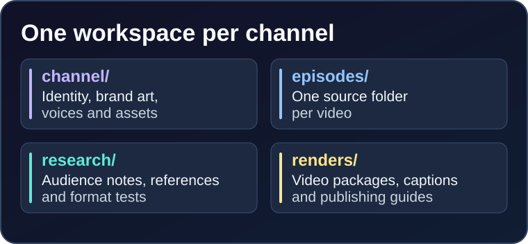

# 🎨 Create a Channel

<p align="center">
  
</p>

A channel is a promise repeated in a recognizable way. The AI can propose the identity, but you should approve the audience, the format and the taste.

## 1. Choose the promise

Write one sentence:

```text
Every [episode length] Short, [character/world] runs into [recurring problem]
and solves it in a surprising visual way.
```

Examples:

- “Every 20-second Short, a tiny robot misunderstands a human instruction.”
- “Every 30-second Short, a paper crane delivers a letter to the wrong place.”
- “Every 15-second Short, a night railway delivers light to somewhere that lost it.”

A good promise is:

- **Specific** enough to recognize in the feed
- **Repeatable** without repeating the same joke
- **Visual** enough to work muted
- **Original** in character, world and voice

> [!WARNING]
> Do not build a channel around another creator’s character, world, voice or edit style. Use references to learn staging, pacing and structure, then make your own.

## 2. Create the workspace

```sh
mkdir -p workspace/my-channel/channel
```

Ask your AI:

```text
Propose three original channel directions for [audience] on [platform].
For each: name, handle, tagline, 2-sentence description, 8 tags,
palette, mark, recurring format and three pilot ideas.
Keep the characters and world original. Wait for my choice.
```

After you choose:

```text
Create workspace/my-channel/channel/channel.json for the chosen direction.
Use the channel schema. Then generate the brand kit and channel.md.
```

## 3. Fill the channel fields

```json
{
  "name": "Paper Crane Post",
  "handle": "@PaperCranePost",
  "tagline": "Small letters. Long flights.",
  "description": "A tiny paper crane delivers one impossible letter at a time. Original animated micro-stories about distance, patience and the places a small message can reach.",
  "tags": ["paper animation", "animated short", "micro story", "paper crane", "quiet comedy"],
  "mark": "PC",
  "palette": {
    "background": "#101820",
    "foreground": "#FFF4E1",
    "accent": "#FF9F68",
    "secondary": "#284B63"
  },
  "captions": {"style": "karaoke", "position": "bottom", "max_words": 4},
  "audio": {"master": {"loudness": -14}},
  "render": {"crf": 16, "preset": "slow", "tune": "animation"}
}
```

| Field | What to fill | Common mistake |
| --- | --- | --- |
| `name` | The channel name | Making it a keyword list |
| `handle` | `@SomethingShort` | Copying a known brand |
| `tagline` | One promise, 3–7 words | Describing the plot of one video |
| `description` | 2–4 sentences with audience and format | Stuffing keywords |
| `tags` | 5–10 real search phrases | 30 vague tags |
| `mark` | 1–6 characters for the logo | A long word that will not fit |
| `palette` | Four hex colours | Too many colours or no contrast |
| `captions` | Style and safe position | Captions over the payoff |
| `audio` | Loudness and reverb defaults | No dialogue headroom |
| `render` | Quality and encode settings | Chasing 4K on a phone-first Short |

> [!TIP]
> Keep `channel.json` as the machine source. Never hand-maintain `channel.md`; regenerate it from JSON.

## 4. Generate the brand kit

```sh
python video.py brand workspace/my-channel/channel/channel.json \
  --out workspace/my-channel/channel/brand
```

This writes:

- `brand/logo.png`
- `brand/banner.png`
- `brand/banner-safe-preview.png`
- `channel/channel.md`
- `channel-publishing.json`

Inspect the logo at avatar size, not full size. Inspect the banner through the safe-area crop. Ask the AI to revise the palette or mark if it does not read at small size.

## 5. Fill the platform profile manually

Use `channel.md` as the copy/paste source.

| Platform | Field | Use |
| --- | --- | --- |
| YouTube | Profile picture | `brand/logo.png` |
| YouTube | Banner | `brand/banner.png` |
| YouTube | Channel description | `channel.md` → YouTube description |
| YouTube | Channel tags | `channel.md` → YouTube tags |
| YouTube | Links | Your site, playlist or newsletter |
| TikTok | Profile photo | `brand/logo.png` |
| TikTok | Bio | `channel.md` → TikTok bio |
| TikTok | Link | Your site or link-in-bio |

Profile and banner crops change. Always preview the upload at phone size.

## 6. Create the first three pilots

Ask for three pilots, not one:

```text
Give me three pilot episodes for this channel.
Each must have a one-line hook, a visible change, a payoff,
a rough runtime, a camera idea and a sound idea.
Keep the production effort similar. Let me choose one.
```

Why three: it tests whether the format has legs, not just one joke.

## 7. Channel checklist

- [ ] Promise is one sentence
- [ ] Name and handle are original
- [ ] Palette passes contrast
- [ ] Logo reads at avatar size
- [ ] Banner survives the safe-area crop
- [ ] Description explains audience and format
- [ ] Tags are real search phrases
- [ ] `channel.md` is generated
- [ ] Three pilots exist
- [ ] First pilot is under 45 seconds
- [ ] No unlicensed character, music or footage

## Next

- [Find Ideas](Find-Ideas)
- [Create Videos with Prompts](Create-Videos-with-Prompts)
- [YouTube and TikTok Monetization](YouTube-and-TikTok-Monetization)
