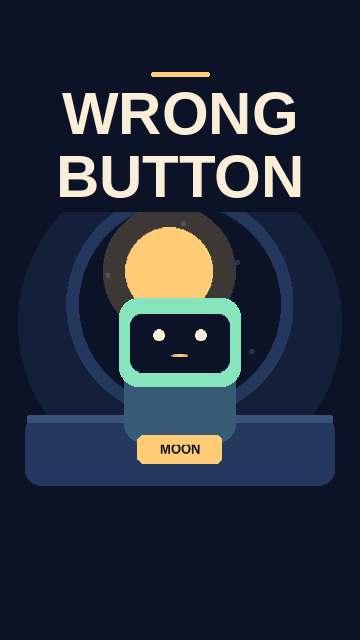
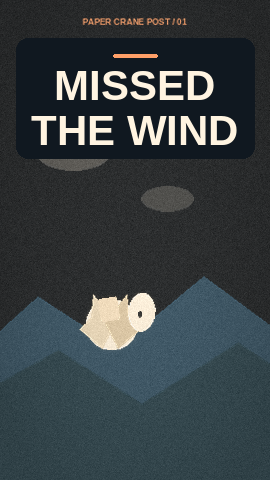
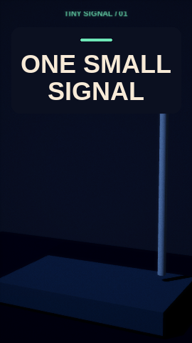

# 🧪 Examples

Explore three original channel workspaces in [the example gallery](https://github.com/fiwon123/viral-short-videos-ai/tree/main/examples). Each includes a playable preview and its editable source.

## 🎬 Orbit Workshop

<a href="https://github.com/fiwon123/viral-short-videos-ai/blob/main/examples/orbit-workshop/renders/the-robot-who-unplugged-the-moon-preview/video.mp4"></a>

[Watch the preview](https://github.com/fiwon123/viral-short-videos-ai/blob/main/examples/orbit-workshop/renders/the-robot-who-unplugged-the-moon-preview/video.mp4) · [Browse the workspace](https://github.com/fiwon123/viral-short-videos-ai/tree/main/examples/orbit-workshop)

- 2D/2.5D robot micro-story
- Karaoke captions
- Layered Foley and a mastered mix

<details>
<summary>Render a fresh preview</summary>

```sh
python video.py render examples/orbit-workshop/episodes/the-robot-who-unplugged-the-moon/episode.json \
  --channel examples/orbit-workshop/channel/channel.json \
  --renderer python --preview --out output/example-previews/orbit-workshop
```

</details>

## 🕊️ Paper Crane Post

<a href="https://github.com/fiwon123/viral-short-videos-ai/blob/main/examples/paper-crane/renders/one-letter-home-preview/video.mp4"></a>

[Watch the preview](https://github.com/fiwon123/viral-short-videos-ai/blob/main/examples/paper-crane/renders/one-letter-home-preview/video.mp4) · [Browse the workspace](https://github.com/fiwon123/viral-short-videos-ai/tree/main/examples/paper-crane)

- Parented paper-crane rig with a pivot
- Camera push-in and animated captions
- Whip transition, grain, and vignette

<details>
<summary>Render a fresh preview</summary>

```sh
python video.py render examples/paper-crane/episodes/one-letter-home/episode.json \
  --channel examples/paper-crane/channel/channel.json \
  --renderer python --preview --out output/example-previews/paper-crane
```

</details>

## 📡 Tiny Signal

<a href="https://github.com/fiwon123/viral-short-videos-ai/blob/main/examples/tiny-signal/renders/one-small-signal-preview/video.mp4"></a>

[Watch the preview](https://github.com/fiwon123/viral-short-videos-ai/blob/main/examples/tiny-signal/renders/one-small-signal-preview/video.mp4) · [Browse the workspace](https://github.com/fiwon123/viral-short-videos-ai/tree/main/examples/tiny-signal)

- Three.js scene with emissive materials
- Camera move and expanding rings
- HyperFrames rendering

<details>
<summary>Render a fresh preview</summary>

```sh
python video.py render examples/tiny-signal/episodes/one-small-signal/episode.json \
  --channel examples/tiny-signal/channel/channel.json \
  --renderer hyperframes --preview --out output/example-previews/tiny-signal
```

</details>

## 🗂️ What each example contains

```text
<example>/
├── channel/
│   ├── channel.json
│   ├── channel.md
│   ├── brief.md
│   └── brand/
├── episodes/<episode>/episode.json
├── research/notes.md
└── renders/<episode>-preview/
    ├── video.mp4
    ├── thumbnail.png
    ├── captions.srt
    └── publishing.md
```

## 🧭 How to use an example

1. Open `channel/channel.md` to see what the channel is and where each block goes.
2. Open `episodes/<episode>/episode.json` to see the timed source.
3. Watch the preview.
4. Read `renders/<episode>-preview/publishing.md` to see the delivery copy.
5. Copy the structure into `workspace/<your-channel>/` and replace the story and assets.

> [!TIP]
> Do not copy the example characters or copy verbatim. Use the structure and build an original world.

## 🔗 Related guides

- [Workspace Layout](Workspace-Layout)
- [Core Concepts](Core-Concepts)
- [QA, Export and Publishing](QA-Export-and-Publishing)
