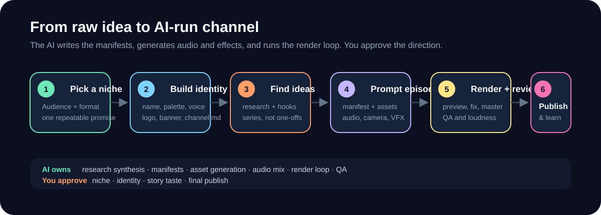

<h1 align="center">🎬 Viral Short Videos AI</h1>

<strong>An AI-first studio for original animated Shorts · Studio documentation</strong>

  
  
  

  

## 🧭 Choose your starting point

| Goal | Start here | What you’ll have |
| --- | --- | --- |
| **Launch a channel** | [Create a Channel](Create-a-Channel) → [Find Ideas](Find-Ideas) | A brand kit, a repeatable series, and ideas for the first episodes |
| **Make one video** | [Create Videos with Prompts](Create-Videos-with-Prompts) → [QA, Export and Publishing](QA-Export-and-Publishing) | A reviewed MP4, thumbnail, captions when needed, and upload copy |
| **Build a production routine** | [Automate a Channel](Automate-a-Channel) → [Make Shorts Travel](Make-Shorts-Travel) | A repeatable batch workflow with a review checklist and analytics loop |
| **Plan for monetization** | [YouTube and TikTok Monetization](YouTube-and-TikTok-Monetization) | A checklist for your platform and the milestones to track |
| **Make characters and moving hooks** | [AI Characters and Hook Clips](AI-Characters-and-Hook-Clips) | A rigged cast that blinks and lip-syncs, and an opening shot that moves |
| **Check what your PC can do** | [Your PC and Performance](Your-PC-and-Performance) | The automatic mode for your machine, and every limit you can change |
| **Review and deliver** | [QA, Export and Publishing](QA-Export-and-Publishing) | Film QA on every render, cold reviews by lens, notes on the frame, and a sealed delivery |
| **Try the tools** | [Quick Start](Quick-Start) → [Examples](Examples) | A first local render and four complete reference projects |

## ✅ Review before publishing

- [ ] Watch the preview on a phone with sound and muted.
- [ ] Check that the first frame sets up the story and the ending delivers the payoff.
- [ ] Read the film-QA report: no frozen ending, no dead stretch, sounds on their frames.
- [ ] Read the thumbnail, captions, and publishing copy at upload size.
- [ ] Run `make deliver` and answer every amber item in `delivery.md`.

## 🛠️ Find a technical answer

- **Project structure** · [Workspace Layout](Workspace-Layout), [Core Concepts](Core-Concepts), [Manifest Reference](Manifest-Reference)
- **AI and performance** · [AI Characters and Hook Clips](AI-Characters-and-Hook-Clips), [Your PC and Performance](Your-PC-and-Performance)
- **Production controls** · [Creative Controls](Creative-Controls), [Audio and Sound Design](Audio-and-Sound-Design), [3D and Renderers](3D-and-Renderers)
- **Advanced controls** · [Masks and markers](Advanced-Controls), [Renderer Support](Renderer-Support)
- **Get unstuck** · [Troubleshooting](Troubleshooting), [FAQ](FAQ), [Contributing](Contributing)
