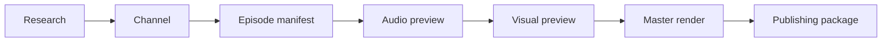

<h1 align="center">🎬 Viral Short Videos AI</h1>

  <strong>An AI-ready, manifest-driven studio for original animated Shorts.</strong> 
  Research a style, build a channel, write a timed episode, generate audio and effects, 
  render a verified MP4, and package the publishing copy.

  
  
  
  

> [!TIP]
> New here? Start with **[Quick Start](Quick-Start)**, then open the **[Examples](Examples)** folder and render one.

## 🚦 Start here

| I want to… | Go to |
| --- | --- |
| Make my first video in 5 minutes | [Quick Start](Quick-Start) |
| Understand the folder layout | [Workspace Layout](Workspace-Layout) |
| Learn the manifest model | [Core Concepts](Core-Concepts) |
| Look up a field | [Manifest Reference](Manifest-Reference) |
| Control camera, motion and rigs | [Motion, Camera and Rigs](Motion-Camera-and-Rigs) |
| Create audio and sound design | [Audio and Sound Design](Audio-and-Sound-Design) |
| Create VFX and transitions | [VFX and Post](VFX-and-Post) |
| Style captions | [Captions and Typography](Captions-and-Typography) |
| Build 3D scenes | [3D and Renderers](3D-and-Renderers) |
| Use AI to make the video | [AI Workflow and Prompt Cookbook](AI-Workflow-and-Prompt-Cookbook) |
| Publish the package | [QA, Export and Publishing](QA-Export-and-Publishing) |
| Fix an error | [Troubleshooting](Troubleshooting) |
| Add a feature or preset | [Contributing](Contributing) |

## 🧭 The pipeline

## 🗂️ What is in the repo

| Path | Purpose |
| --- | --- |
| `studio/` | Python engine, schema and renderers |
| `browser/` | HyperFrames and Remotion painters |
| `presets/` | Style, camera and finishing presets |
| `examples/` | Three complete public example workspaces |
| `wiki/` | Source for this wiki |
| `workspace/<channel>/` | Your private channel, episodes, research and renders |
| `channels/`, `episodes/`, `output/` | Legacy local layout, still supported |
| `reference-media/` | Local source videos for study |

## 🎨 What the studio can do

| Area | Controls |
| --- | --- |
| **Motion** | 13 easings, parent/pivot rigs, visible variants, camera presets and shake, motion blur, 2× supersampling |
| **Picture** | Post grade, bloom, blur, grain, vignette, chromatic split, letterbox, blend modes, 17 transitions |
| **Audio** | Kokoro or recorded voices, 32 Foley recipes, layered SFX, pan, reverb, pitch variance, room tone, −14 LUFS master |
| **Captions** | Box, karaoke and minimal styles, word timing, highlight, animation, font and colour controls |
| **VFX** | 18 palette-matched SVGs plus a parameterized Effect Lab |
| **3D** | Three.js scene libraries, PBR materials, emissive objects, GLB clips, ACES tone mapping |
| **Output** | MP4, SRT, thumbnail, timed script, QA report and platform-ready publishing copy |

## 🧪 Examples

| Example | Renderer | Shows |
| --- | --- | --- |
| [Orbit Workshop](Examples#orbit-workshop) | Python | 2D/2.5D layers, karaoke and Foley |
| [Paper Crane Post](Examples#paper-crane-post) | Python | Parented rig, camera push-in, slide caption, whip transition |
| [Tiny Signal](Examples#tiny-signal) | HyperFrames | 3D scene, PBR/emissive materials, camera move |

## 📄 License

MIT. See the repository [LICENSE](https://github.com/fiwon123/viral-short-videos-ai/blob/main/LICENSE).
