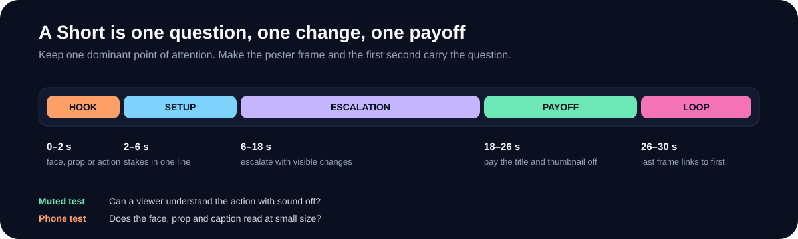

# 📈 Make Shorts Travel

  

No one can guarantee a viral video. You can increase the chance that the right viewer stops, watches to the end, and shares by making the first second clear and the payoff worth the wait.

## The six things that matter

### 1. One question in the first second

The viewer should know what they are waiting for:

- What is behind the door?
- Will the crane catch the letter?
- Why is the robot pressing the wrong button?

Start on the face, prop or action that raises the question. Do not open on an empty establishing shot unless the emptiness is the question.

### 2. One visible change

A Short is not a monologue with pictures. Something must change:

- A prop moves
- A character changes pose
- A light changes
- A scale changes
- A new object enters

If the viewer can skip 10 seconds and miss nothing, the middle is too static.

### 3. One payoff

Pay off the title, thumbnail and first frame. Do not introduce a second joke at the end. Hold the payoff long enough to register, then get out.

### 4. Loop

The last frame should lead naturally back to the first:

- A door closes and reopens
- A character returns to the start pose
- A sound or line repeats
- A camera move reverses

A loop is not a trick; it is a second viewing.

### 5. Captions and sound that survive the phone

- Keep captions short and clear.
- Put the active word on the spoken word.
- Keep music under dialogue.
- Put the contact sound on the contact frame.
- Check on a phone speaker, not just headphones.

### 6. A repeatable signature

The audience should recognize the next video before the title:

- Same character silhouette
- Same palette and type
- Same opening rhythm
- Same payoff family
- Same runtime range

Consistency is how a viewer becomes a subscriber.

## Pacing template

| Time | Job | Check |
| --- | --- | --- |
| 0–1 s | Face, prop or action | Can you tell what to watch? |
| 1–2 s | The question | Would you keep watching? |
| 2–6 s | Setup | Is the stakes clear without a paragraph? |
| 6–18 s | Escalation | Does something visible change every 2–4 s? |
| 18–26 s | Payoff | Does it pay off the hook? |
| 26–30 s | Loop | Does the last frame lead back? |

For a 45–60 s Short, extend the escalation, not the setup. For TikTok Creator Rewards, the video must be at least 1 minute; make the story earn that minute rather than padding it.

## Hook patterns that work

| Pattern | Example |
| --- | --- |
| Wrong expectation | “This button definitely does not open the moon.” |
| Forbidden action | “Do not press the yellow one.” |
| Wrong recipient | A letter arrives at the wrong planet |
| Escalating mistake | One small error becomes three |
| Exact instruction | A literal reading of a normal human phrase |
| Countdown | Three attempts, one second each |
| Visual contradiction | A tiny character with an enormous prop |

## Test one variable at a time

Change one thing per upload:

- Hook framing
- Opening line
- Caption style
- Runtime
- Payoff hold
- Thumbnail text

Compare uploads at the same age, not raw lifetime views. Look at:

- First-second retention
- Average view duration
- Completion
- Shares
- Saves
- Comments that quote a specific moment

## Common failure modes

| Problem | Fix |
| --- | --- |
| Slow opening | Start on the action; remove the establishing shot |
| Explanation | Replace a line with a visible action |
| Flat middle | Add a new obstacle or visual change every 2–4 s |
| Weak payoff | Make the answer visible, not narrated |
| No loop | End on the start pose or return the prop |
| Captions cover the action | Move captions or reframe |
| Loud music | Duck harder under dialogue |
| Unclear character | Increase silhouette, contrast and size |
| Too long | Cut the setup, not the payoff |

## Do not chase virality by copying

Use references to learn structure. Build original characters, jokes, voices and art. Reuploads, compilations and unedited third-party clips are risky for policy and monetization.

## Next

- [YouTube and TikTok Monetization](YouTube-and-TikTok-Monetization)
- [Automate a Channel](Automate-a-Channel)
- [QA, Export and Publishing](QA-Export-and-Publishing)
