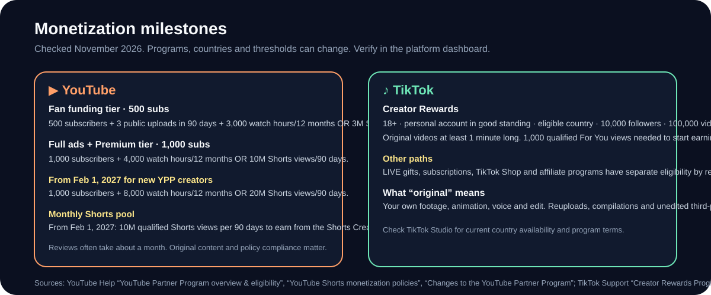

# 💰 YouTube and TikTok Monetization

  

> [!IMPORTANT]
> Eligibility depends on your region, account, and content. Check YouTube Studio → Earn and TikTok Studio → Monetization for the requirements that apply to you.

## ▶️ YouTube Partner Program

### Entry paths

| Path | Requirements | What it unlocks |
| --- | --- | --- |
| **Expanded YPP / fan funding** | 500 subscribers and 3 valid public uploads in 90 days, plus either 3,000 qualified watch hours in 12 months or 3M qualified Shorts views in 90 days | Fan funding and Shopping features in eligible countries |
| **Full YPP ads + Premium** | 1,000 subscribers and either 4,000 qualified watch hours in 12 months or 10M qualified Shorts views in 90 days | Ads and YouTube Premium revenue |
| **New YPP entry from Feb 1, 2027** | 1,000 subscribers and either 8,000 qualified watch hours in 365 days or 20M qualified Shorts views in 90 days | Ads and Premium entry under the updated terms |

Also required:

- Follow [YouTube channel monetization policies](https://support.google.com/youtube/answer/1311392)
- Live in an eligible country
- No active Community Guidelines strikes
- 2-Step Verification on the Google account
- Advanced features access
- An active AdSense for YouTube account linked to the channel

Review typically takes **about one month**. If rejected, you can appeal within 21 days or reapply after 30 days (or 90 days for a later reapplication).

### How Shorts revenue works

- You must accept the **Shorts Monetization Module**.
- Shorts ad revenue is pooled from ads between Shorts, allocated to creators based on engaged views, and the creator keeps **45%** of their allocation.
- Music affects the pool calculation because YouTube allocates part of the revenue to music licensing.
- Only original, advertiser-friendly, engaged views count. Reuploads, compilations and artificial views are not a safe path.
- From **February 1, 2027**, earning from the Shorts Creator Pool each month requires **10M qualified Shorts views in YouTube’s 90-day measurement window**. The window ends on the 15th of the month before the earnings month. [Shorts monetization policy](https://support.google.com/youtube/answer/12504220)
- Shorts up to 3 minutes can use the Shorts revenue model. Shorts over one minute with claimed content can be blocked, so music rights matter.

### YouTube practical checklist

- [ ] 2-Step Verification on
- [ ] Advanced features enabled
- [ ] Channel follows monetization policies
- [ ] Original animation, voice and music
- [ ] No active strikes
- [ ] AdSense account ready
- [ ] `Get notified` enabled in Studio → Earn
- [ ] Apply when eligible
- [ ] Accept updated terms before **January 31, 2027** if you are already monetizing

## 🎵 TikTok

### Creator Rewards

| Requirement | Detail |
| --- | --- |
| Age | 18+ (19+ in South Korea) |
| Account | Personal account in good standing |
| Country | Eligible region |
| Followers | 10,000 |
| Views | 100,000 video views in the last 30 days |
| Content | Original, eligible videos posted after joining |
| Length | Videos at least **1 minute** |
| Start earning | 1,000 qualified For You feed views on eligible videos |

Other TikTok monetization paths — LIVE gifts, subscriptions, TikTok Shop and affiliate programs — have separate requirements by country and account type. Check TikTok Studio for your region.

### What “original” means

| ✅ Start with | ❌ Exclude from Creator Rewards planning |
| --- | --- |
| Animation, characters, scripts, and edits you create | Reuploads, clips with minor edits, or compilations of other creators’ material |
| Original audio or music you have the rights to use | Duets, Stitches, and sponsored posts |
| Eligible videos posted after joining | Artificial, paid, or otherwise unqualified views |

## 📊 Revenue reality

Monetization is a lagging indicator. A channel with a clear series and strong retention is more valuable than a channel that only chases a payout threshold.

Revenue varies by:

- Country and audience
- Season and advertiser demand
- Format and length
- Music licensing
- Completion and engaged views
- Whether the viewer is in a high-value market

Do not promise a RPM. Model low, medium and high cases, and separate platform revenue from brand deals, affiliate income, products and licensing.

## 🧠 Strategy that fits the rules

### YouTube

- Use Shorts for reach and discovery.
- Build a repeatable series so viewers subscribe, not just watch one clip.
- Add a longer-form or community layer when it supports the audience.
- Keep the 90-day Shorts view window in mind; consistency matters more than one spike.
- Do not pad a Short just to hit a length. 3-minute Shorts are allowed, but the story must earn it.

### TikTok

- Creator Rewards needs 1+ minute videos. Build a 60–90 second version of stories that can support it.
- Keep a shorter 20–45 second cut for reach and testing.
- Do not stretch a 20-second gag into 60 seconds with filler. That hurts retention.
- Use TikTok as a discovery engine and YouTube as a library when the format fits.

### Both

- One idea, one visible change, one payoff.
- Original characters and voice.
- Captions that read on a phone.
- A loop or a reason to rewatch.
- A series promise that survives 30 uploads.

## ✅ Monetization checklist

- [ ] Channel identity is complete
- [ ] 30+ episode ideas fit the format
- [ ] First 5 uploads are original and consistent
- [ ] Captions, sound and thumbnail pass phone review
- [ ] Analytics reviewed at the same age
- [ ] Platform rules checked in your country
- [ ] No reused or unlicensed assets
- [ ] Tax and payment details ready
- [ ] Brand-deal and affiliate options considered separately

## Sources

- [YouTube Partner Program overview & eligibility](https://support.google.com/youtube/answer/72851)
- [Expanded YouTube Partner Program](https://support.google.com/youtube/answer/13429240)
- [YouTube Shorts monetization policies](https://support.google.com/youtube/answer/12504220)
- [Changes to the YouTube Partner Program](https://support.google.com/youtube/answer/12843009)
- [TikTok Creator Rewards Program](https://support.tiktok.com/en/business-and-creator/creator-rewards-program/creator-rewards-program)
- [TikTok Creator Academy: Creator Rewards](https://www.tiktok.com/creator-academy/article/creator-rewards-program)

## 🔗 Related guides

- [Make Shorts Travel](Make-Shorts-Travel)
- [Automate a Channel](Automate-a-Channel)
- [Create a Channel](Create-a-Channel)
