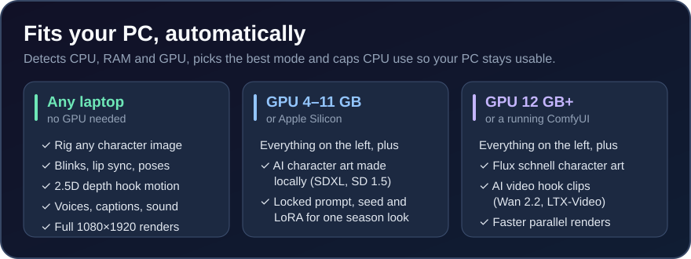

# 💻 Your PC and Performance

The studio fits itself to your computer. You never have to configure hardware, and it never tries to use more CPU or GPU than your PC can spare.

<p align="center">
  
</p>

## See what your PC gets

```sh
make hardware
```

It prints:

- **`profile`:** the tier and budget for your machine.
- **`plan`:** what `make art` will use.
- **`video_plan`:** what `make hero` will use.

Your AI assistant runs it at the start of a session and follows it without asking you.

## Tiers

| Tier | When | CPU threads | Episodes at once | Browser workers |
| --- | --- | --- | --- | --- |
| **low** | 4 cores or fewer, or under 8 GB RAM | half the cores | 1 | 1 |
| **mid** | everything else | cores − 2 | 1, or 2 with 8+ cores and 16+ GB | 2 |
| **high** | a 12 GB+ GPU, or 12+ cores with 32+ GB RAM | cores − 1 | 2–4 | 2–4 |

On every tier:

- studio commands run at **below-normal priority**, so your PC stays responsive;
- FFmpeg's H.264 encoder, ONNX models and torch use the thread budget;
- an **image model never runs on the CPU** unless you allow it: it takes minutes per image and keeps the CPU busy;
- a GPU under 4 GB is treated as absent for image models, and AI video needs 12 GB.

## Change any limit

Set these in your environment or in your `.env` file. All are optional.

| Variable | What it does |
| --- | --- |
| `STUDIO_PROFILE` | Force `low`, `mid` or `high` |
| `STUDIO_THREADS` | CPU threads for encoders and models |
| `STUDIO_JOBS` | Episodes rendered at once by `make batch` |
| `STUDIO_BROWSER_WORKERS` | Chromium workers per render |
| `STUDIO_NICE` | Priority from 0 (normal) to 19 (lowest); default 10 |
| `STUDIO_CPU_AI` | `1` lets `make art` run an image model on the CPU |
| `STUDIO_COMFYUI_URL` | Where ComfyUI runs (default `http://127.0.0.1:8188`) |
| `STUDIO_DEPTH_MODEL`, `STUDIO_CUTOUT_MODEL` | Use another ONNX depth or cut-out model |

`make hardware` lists the ones it picked up under `overrides`.

## Speed tips

- Review with `make preview HOOK=20` (the opening 20 seconds) and `make still` frames before a full render.
- Run `make art-models` once: the real depth and cut-out models are faster to review than fixing rough fallbacks.
- A GPU helps AI art and video most. Rendering itself is CPU work, so more cores make full renders faster.

## 🔗 Related guides

- [AI Characters and Hook Clips](AI-Characters-and-Hook-Clips)
- [Quick Start](Quick-Start)
- [Troubleshooting](Troubleshooting)
